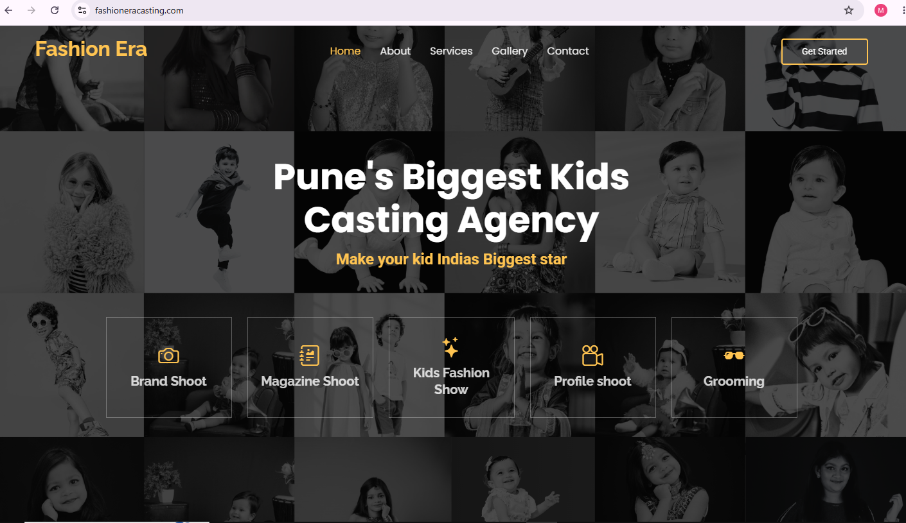
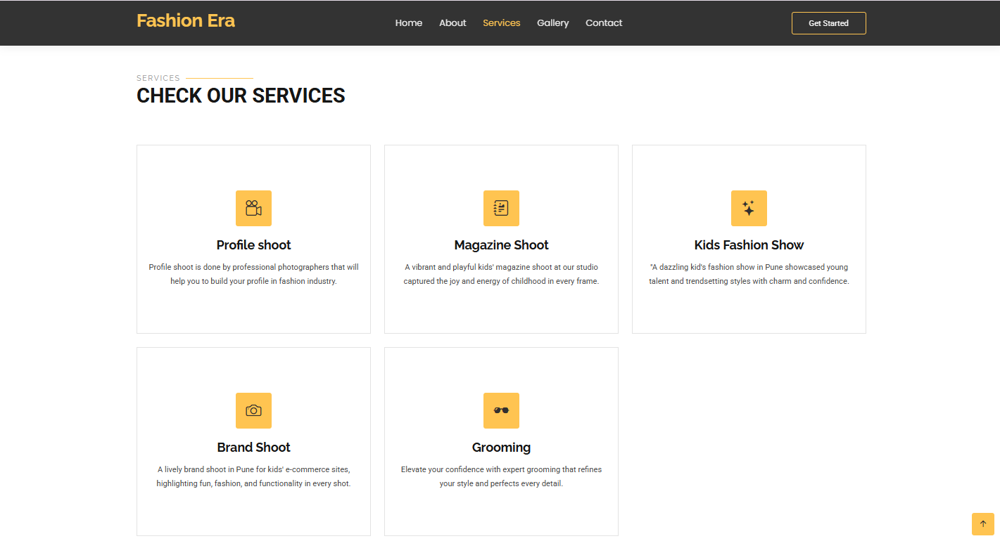
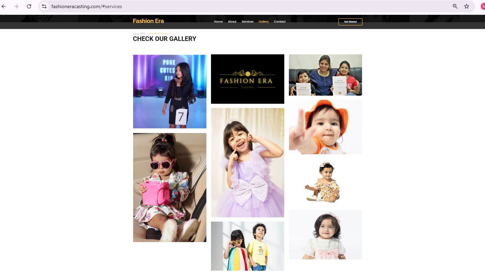
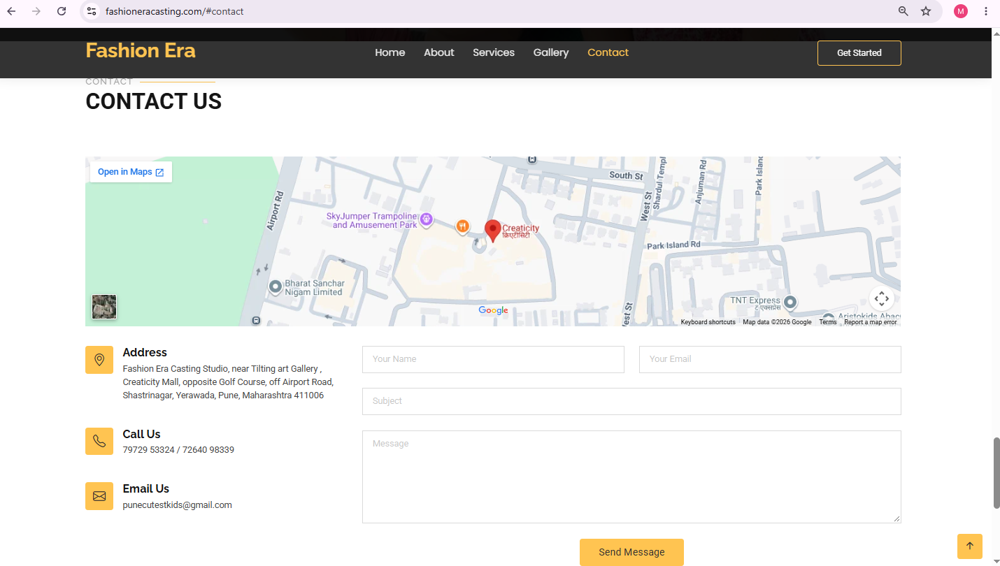

# Fashion Era : Kids Casting & Production Website

🔗 **Live site:** [fashioneracasting.com](https://www.fashioneracasting.com/)

A responsive website for **Fashion Era**, a Pune-based kids' casting and production company (founded in 2019) that offers brand shoots, magazine shoots, kids' fashion shows, and portfolio shoots.

> ⚠️ **Note:** This is a live client project. The source code is private for client confidentiality, so this repository only showcases the work.

---

## 📸 Screenshots

| Home | Services |
|------|----------|
|  |  |

| Gallery | Contact |
|---------|---------|
|  |  |

---

## ✨ Features

- **Single-page responsive layout** with smooth scrolling navigation
- **Hero section** with calls to action for booking
- **About section** with production offerings and a strip of client brand logos
- **Services:** Brand Shoot, Magazine Shoot, Kids Fashion Show, Profile Shoot, and Grooming
- **Masonry portfolio gallery** showing past shoots
- **Testimonials** from parents
- **Contact form** with loading and success states
- **Social media links** (Facebook and Instagram)
- **SEO-optimised** meta tags aimed at local Pune searches
  

---

## 🛠️ Tech Stack

- **Frontend:** HTML5, CSS3, Bootstrap, JavaScript (customised HTML template)
- **Contact form:** PHP `mail()`

---

## 👩‍💻 My Role

- Customised a Bootstrap HTML template into a full brand website
- Made the layout responsive for all screen sizes
- Built the contact form with PHP mail
- Set up SEO meta tags for local search
- Deployed the site 
---

## 📬 Contact

**Manjushree C** — chabukswarmanjushree18@gmail.com
